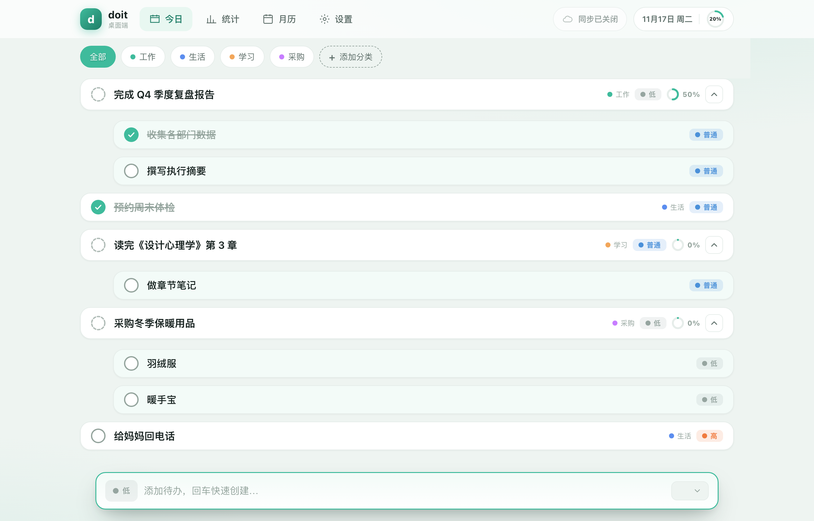
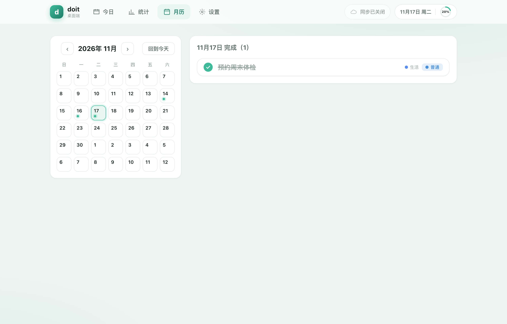
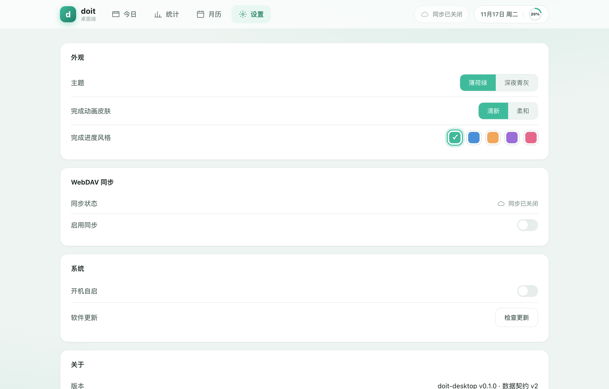

# doit-desktop

doit 待办应用的**桌面端**（macOS / Windows / Linux）：Vue 3 + TypeScript + Tauri 2 构建，与手机端共享同一份 `doit-backup.json` 数据，支持 WebDAV 双向同步。

> 项目：`doit`（Android 待办）的桌面 companion · 数据契约 v2 · Tauri 2 + Vue 3

---

## 特性

- **今日待办**：分类胶囊筛选 + 顶级任务/子任务树形分层；顶栏同步按钮左侧的「紧急优先」红色开关按顶级任务优先级排序（4→0，子任务顺序不变，偏好本地保存；仅今日页显示）；父任务左侧虚线只读圈（完成态由子任务推导），子任务实色圈可单个勾选；右击卡片可改优先级 / 改分类 / 删除
- **优雅地标记完成**：点击圆圈直接完成；**按住卡片约 0.9 秒**走满进度条才完成，中途松手进度回退（可自选进度条颜色）
- **统计**：完成热力图（近一周 / 近一月 / 近一年）、按分类的完成占比（图例列出全部分类，无数据补 0）、每日/每月完成趋势
- **月历**：月份小日历标记完成日，右侧列出当日完成清单，可左右翻月、一键回到今天
- **设置**：薄荷绿 / 深夜灰青双主题、清新 / 柔和完成动画皮肤、进度色板；WebDAV 同步（凭据写入系统钥匙串，明文不落盘）；支持开机自启、托盘、应用内检查更新
- **真实数据**：无内置示例任务，全部操作落到本地 JSON 快照；与手机端经 WebDAV 互通（同一 `doit-backup.json`）

## 截图

| 今日待办 | 统计 |
| --- | --- |
|  |  |

| 月历 | 设置 |
| --- | --- |
|  |  |

> 以上为桌面端实际运行界面（带示例数据渲染）。

---

## 技术栈

| 层次 | 选型 |
| --- | --- |
| 界面 | Vue 3.5 + TypeScript + Vite 8 + Vue Router + Pinia |
| UI 原语 | Reka UI（右键菜单 / 下拉 / 弹层） |
| 样式 | 手写设计令牌 CSS + Tailwind 4（仅 `components/ui/`） |
| 图表 | ECharts（热力图 / 环形图 / 折线） |
| 桌面壳 | Tauri 2（托盘、开机自启、自动更新、WebDAV 走 Rust 网络栈） |
| 数据 | 本地 JSON 快照原子写，系统钥匙串存 WebDAV 凭据 |

## 目录结构

```
doit-desktop/
├── src/                  # Vue 前端（views / components / stores / domain / services）
├── src-tauri/            # Tauri 壳（Rust commands / 托盘 / 自启 / 快照存储）
├── tests/                # Vitest 单元与组件测试
├── docs/screenshots/     # 本 README 配图
├── release.sh            # 发版脚本（自动版本号 + 打 tag + 推送）
└── .github/workflows/    # GitHub Actions（ci.yml 校验 / release.yml 三平台出包）
```

---

## 快速开始（开发）

环境要求：Node ≥ 20.19（推荐 22）、Rust stable、各平台 Tauri 系统依赖，`npm install`。

```bash
npm install          # 安装依赖（含 Rust 侧，由 cargo 自动拉取）
npm run tauri dev    # 开发模式：Vite HMR + Tauri 窗口（前后端热更）
```

常用脚本：

```bash
npm test             # Vitest 单元 / 组件测试
npm run build        # 类型检查（vue-tsc）+ 前端产物构建
npm run tauri build  # 出当前平台的安装包（macOS .dmg / Windows .exe / Linux .deb）
```

### 使用要点

- 底部输入框：左侧选优先级（紧急 / 高 / 普通 / 低，圆角矩形 + 颜色标识），右侧选分类，回车即添加
- **回车连续添加**；在父任务卡片上点「+」直接在当前展开区添加子任务
- 右键任务卡片：修改子任务/优先级、改分类、删除；已完成任务仅允许删除
- 有子任务的父任务完成状态**由所有子任务自动推导**，不可单独勾选
- 统计图例 / 热力色块可悬停查看明细

---

## 发版方式

发版全程由一个脚本完成：**自动推算下一个版本号 → 同步四处版本 → 提交 → 打 tag → 推送 → 触发 GitHub Actions 三平台构建并发布 Release**。

```bash
./release.sh                 # 补丁版：v0.1.0 → v0.1.1（默认）
./release.sh patch           # 同上，显式补丁版
./release.sh minor           # 次版本：v0.1.1 → v0.2.0
./release.sh major           # 主版本：v0.2.0 → v1.0.0
./release.sh 1.2.3           # 手动指定完整版本号
./release.sh minor --dry-run # 只打印将打的版本，不做任何操作
```

版本号会同步到 4 处：`package.json` / `package-lock.json` / `src-tauri/tauri.conf.json` / `src-tauri/Cargo.toml` + `Cargo.lock`。

### CI 流水线（.github/workflows/）

| 工作流 | 触发 | 做什么 |
| --- | --- | --- |
| `ci.yml` | push `main` / PR | 单元测试 + 类型检查 + 前端构建（轻量门禁） |
| `release.yml` | push `v*` tag（或手动触发） | **macOS（Apple Silicon + Intel）→ Windows（NSIS）→ Linux（.deb）** 三平台并行构建，再由 `release` job 汇总发布到 GitHub Release |

产物命名形如 `doit-desktop-v0.1.0-*.dmg / .exe / .deb`。

### 自动更新签名（可选）

默认首次发版为**未签名**安装包。要开启应用内自动更新签名，需在仓库 `Settings → Secrets and variables → Actions` 添加：

- `TAURI_PRIVATE_KEY`：Tauri/minisign 私钥全文（本地用 `npm run tauri signer generate -w ~/.tauri/doit-desktop.key` 生成）
- `TAURI_KEY_PASSWORD`：对应口令

配置后下次 `./release.sh`，CI 会自动产出带签名的 updater 产物（`latest.json` + `.sig`），应用即可自动检测更新。

> 注意：`release.sh` 需要能 push 到远端（本仓库走 `git@github.com:nabaonan/doit-desktop.git`，SSH 免密）；tags 与 `main` 均推送到 `nabaonan/doit-desktop`。

---

## 数据与同步

- 本地数据：应用数据目录下的 JSON 快照（原子写 + 备份轮转），浏览器降级模式存 `localStorage`
- WebDAV：在设置页开启后填写服务器 / 账号 / 密码，凭据仅写入系统钥匙串；同步文件固定名 `doit-backup.json`，与手机端共用
- 同步状态：顶部云图标显示「已同步 / 有待同步 / 同步中 / 已关闭」，点击可手动同步

## 许可证

私有项目（私有仓库），暂未开源。
